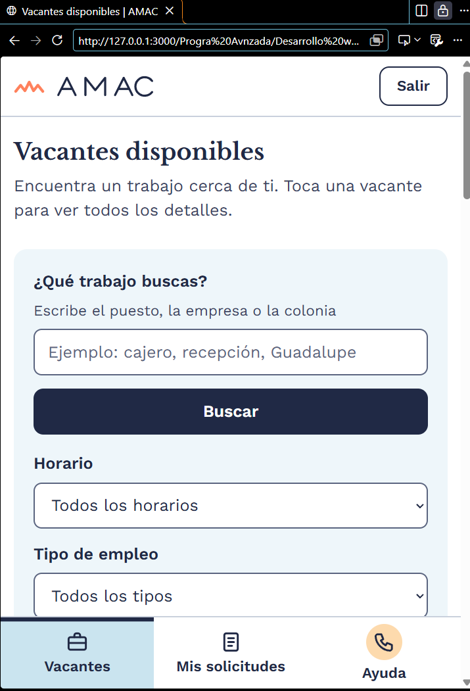
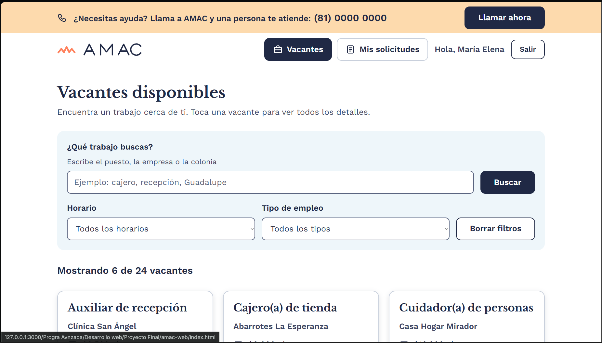
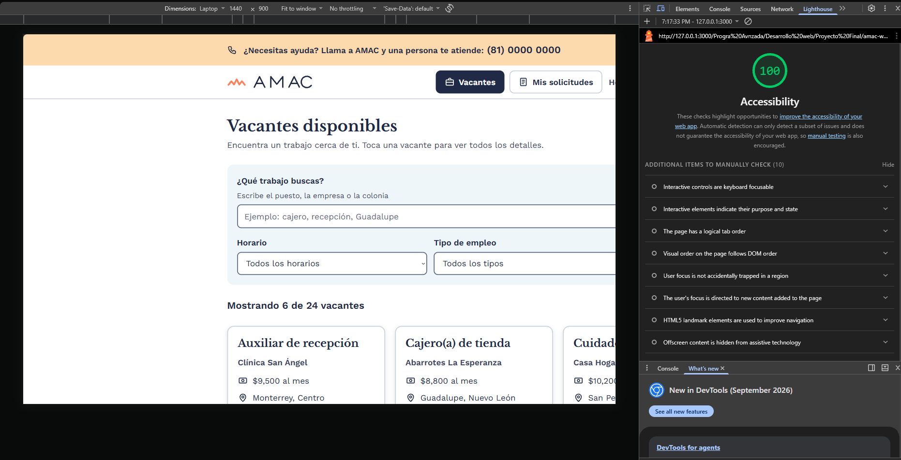

# Plataforma AMAC – en HTML y CSS 

Proyecto final OT2026-WEB.

- **Repositorio:** (https://github.com/Firedus/Proyecto-Final-desWeb)
- **Sitio publicado:** (https://proyecto-final-desweb.vercel.app)
- **Prototipo de Figma:** (https://www.figma.com/design/2dsxPtvnSnlVXsfGzjUHMI/AMAC-Bolsa-de-Trabajo---Prototipo-UI?node-id=0-1&t=cTw5ZSiES6MqYZh0-1)

## Integrantes y aportes

| Integrante | Qué hizo |
[Emilio Gael Serrano Carrasco] | `index.html`, `vacante.html`, `login.html`, `registro-candidato.html`,
`mis-solicitudes.html` y `empresa-vacantes.html`,
`registro-empresa.html`, `solicitudes-recibidas.html`, `solicitud-enviada.html`,
`registro-enviado.html` y `404.html`.

## Paleta de colores y tipografía

| Uso | Color |
|---|---|
| Texto, botones y menú | `#202945` (azul AMAC) |
| Texto secundario | `#3A4361` |
| Fondos claros | `#EEF6FA`, `#CAE4EF` (azul claro) y `#FDDAAD` (durazno) |
| Acento (solo decorativo) | `#FF815C` |
| Bordes de campos | `#5B6580` |
| Éxito / error | `#14602F` / `#A8231B` |

Contraste medido con el plugin Contrast de Figma: blanco sobre `#202945` = 14.33:1 y
`#202945` sobre `#CAE4EF` = 10.82:1 (los dos cumplen AAA).

Tipografía: **Libre Baskerville** (títulos) y **Work Sans** (contenido), de Google Fonts.
El texto base es de 20 px (`1.25rem`) y nunca baja de 18 px (`1.125rem`).

## Componentes reutilizables

| Clase | Para qué sirve |
|---|---|
| `.boton` (`--primario`, `--secundario`, `--peligro`, `--bloque`, `--chico`) | Botones y enlaces con forma de botón (56 px de alto) |
| `.tarjeta-vacante` | Tarjeta del listado de vacantes |
| `.tarjeta-fila` | Fila de tarjeta para solicitudes, vacantes de la empresa y postulantes |
| `.estatus` (`--enviada`, `--revision`, `--aceptada`, `--rechazada`, `--cancelada`, `--publicada`, `--pausa`, `--cerrada`) | Etiqueta de estatus (siempre con texto) |
| `.etiqueta` | Categoría de la vacante |
| `.mensaje` (`--info`, `--exito`, `--error`, `--aviso`) | Mensajes con ícono |
| `.campo-formulario` | Etiqueta + ayuda + campo (y versión con error) |
| `.opcion` | Opción de selección única, en tarjeta grande |
| `.casilla` | Casilla de verificación grande |
| `.seccion-formulario` | Sección numerada de un formulario largo |
| `.panel`, `.panel-postular`, `.dato-resumen` | Cuadros de fondo suave |
| `.lista-check`, `.pasos` | Lista con palomitas y lista de pasos numerados |
| `.navegacion`, `.encabezado`, `.pie`, `.ayuda` | Menú, encabezado, pie y franja de ayuda (RF-052) |

### Capturas del Proyecto

**Vista en Celular:**

**Vista en Escritorio:**

**Puntaje de Accesibilidad (Lighthouse):**

